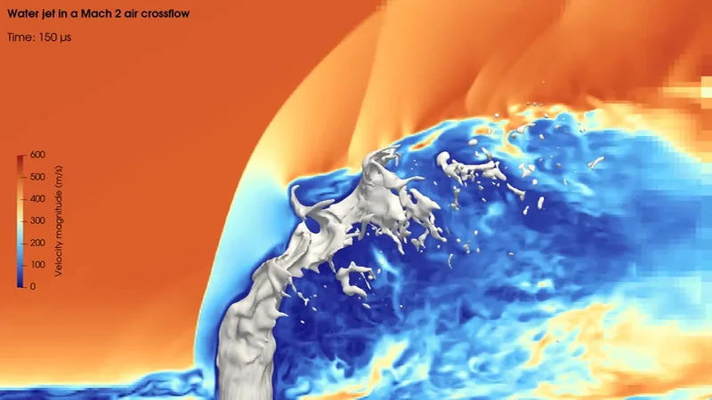

# shockVoF

[](https://github.com/imfd-stroemungsmechanik/shockVoF/actions/workflows/build-and-test.yml)
[](https://openfoam.org)
[](LICENSE)
[](https://doi.org/10.5281/zenodo.24480457)

<p align="center">
  <a href="https://github.com/user-attachments/assets/3b2d6b1c-579b-4847-836a-c3f1a94daaa3">
    
  </a>
  <br><sub>Click for the full-resolution video</sub>
</p>

`shockVoF` is a density-based Volume-of-Fluid solver for compressible two-phase flows implemented in the open-source CFD software [OpenFOAM 14](https://openfoam.org). Its field of application is high-speed atomization of liquids, where both phases experience strong compressibility effects and shock waves interact with material interfaces.

## Model

It is based on the six-equation model of Saurel, Petitpas and Berry (2009), with each phase closed by an ideal-gas or stiffened-gas equation of state, and applies the closed-form stiffened-gas pressure relaxation of Pelanti and Shyue (2014) in the variant of Bharate and Mandal (2026), which relaxes the phase pressures to the capillary equilibrium. A seventh conservative equation for the mixture total energy is solved additionally to conserve global energy and recover the correct shock jumps. The hyperbolic system is integrated explicitly by a finite-volume scheme combining MUSCL reconstruction, an HLLC approximate Riemann solver and a strong-stability-preserving Runge-Kutta method, giving second-order accurate spatial and temporal discretization. Optional $\rho$-THINC sharpening controls interface diffusion and a well-balanced continuum-surface-force model represents capillary effects.

## Key features

- Ideal-gas or stiffened-gas equation of state per phase with support for temperature-dependent viscosity and conductivity.
- Closed-form solution of the stiffened-gas pressure relaxation (Pelanti & Shyue 2014) to the capillary equilibrium $p_1 - p_2 = \sigma\kappa$ with the pre-relaxation interface pressure (Bharate & Mandal 2026), followed by a total-energy-conservative Kapila mixture-EoS decode (Kapila et al. 2001).
- Runtime-selectable primitive-variable MUSCL reconstruction with a positivity-preserving limiter (Zhang & Shu 2010) and optional runtime-selectable $\rho$-THINC interface sharpening (Garrick et al. 2017b).
- HLLC (Toro et al. 1994) flux scheme with Davis (1988) wave-speed estimates, the mixture total-energy star state of Bharate and Mandal (2025), a well-balanced surface-tension contact wave (Garrick et al. 2017a), HLLC-consistent volume-fraction advection (Johnsen & Colonius 2006) and a low-Mach correction (Chen et al. 2020), active by default, with a capillary-velocity cutoff at interfaces.
- Explicit second-order s-stage SSP(s,2) scheme (Ketcheson 2008).
- Single-pass flux-corrected transport (FCT) limiter (Zalesak 1979) within each stage, which blends the high-order fluxes with first-order HLL fluxes (Harten et al. 1983) so that the inviscid update keeps the partial densities and the phasic and mixture energies non-negative.
- Continuum-surface-force momentum and energy sources (Brackbill et al. 1992) with runtime-selectable curvature models.
- Momentum transport modeled via the OpenFOAM laminar, RAS and LES models of linear eddy-viscosity type, either as a single mixture model or per phase. The per-phase mode is, however, not yet part of the verification suite.
- Support for unstructured meshes and mesh topology changes (e.g., adaptive refinement through OpenFOAM's dynamic mesh framework). The latter is, however, not yet part of the verification suite.
- Adaptive time step size based on the acoustic Courant number from the Riemann-solver signal speeds and on the interface Courant number.

## Requirements and build

The `shockVoF` solver suite requires the following software to be installed:
- [OpenFOAM 14](https://openfoam.org)
- [Python 3](https://www.python.org/) with [NumPy](https://numpy.org/) (2.0 or newer), [Matplotlib](https://matplotlib.org/) (3.8 or newer) and [SciPy](https://scipy.org/) for the post-processing scripts
- [ParaView](https://www.paraview.org) for flow visualization (optional)

With an OpenFOAM environment sourced, execute the following build script:

```bash
./Allwmake
```

The libraries are then installed in `$FOAM_USER_LIBBIN`. A case selects the solver module with `solver shockVoF;` in `system/controlDict` and is run with `foamRun`.

## Verification and validation

A suite of verification and validation cases is provided with their respective scripts `Allrun` and `validateResults.py` for running and post-processing. Except for `interfaceAdvection` and `waterAirShockTube`, the cases run in parallel. `run/verification/Allrun` runs the complete verification suite.

### Verification

| Case                                                                      | Focus                                                                                         |
|---------------------------------------------------------------------------|-----------------------------------------------------------------------------------------------|
| [`interfaceAdvection`](run/verification/interfaceAdvection)               | Pressure-velocity equilibrium at an advected material interface                               |
| [`isentropicVortexAdvection`](run/verification/isentropicVortexAdvection) | Formal order of accuracy of the reconstruction on a smooth flow                               |
| [`oscillatingDroplet`](run/verification/oscillatingDroplet)               | Oscillation period and numerical dissipation of a capillary flow over a range of Mach numbers |
| [`staticDroplet`](run/verification/staticDroplet)                         | Laplace pressure jump and spurious currents of the well-balanced surface tension              |
| [`waterAirShockTube`](run/verification/waterAirShockTube)                 | Shock/interface interaction across a large density and impedance jump                         |
| [`zalesakDisk`](run/verification/zalesakDisk)                             | Shape preservation of interface transport with and without $\rho$-THINC sharpening            |

### Validation

| Case                                  | Focus                                                                       |
|---------------------------------------|-----------------------------------------------------------------------------|
| [`Igra2001`](run/validation/Igra2001) | Shock-induced deformation and drift of a water column at Ma = 1.47          |
| [`Lin2020`](run/validation/Lin2020)   | Trajectory and liquid distribution of a water jet in a Mach 2 air crossflow |

### Parallel scaling

The study in [`run/scalability`](run/scalability) measures the strong and weak scaling of a three-dimensional shock-droplet interaction on up to 6656 cores.

## Limitations

The solver `shockVoF` has the following limitations:
- Exactly two phases, each closed by an ideal-gas or a stiffened-gas equation of state without phase change.
- Only instantaneous pressure relaxation, no thermal relaxation.
- No gravity or other body forces are considered.
- No `fvModels` or `fvConstraints` are applied.
- No support for mesh motion.

## License

`shockVoF` is free software, released under the GNU General Public License version 3 or later; see [LICENSE](LICENSE). It is based on OpenFOAM, which is distributed under the same license.

## Citation

If you use `shockVoF` in your work, please cite the archived release on Zenodo:

Heinrich, M. (2026). shockVoF: A density-based Volume-of-Fluid solver for compressible two-phase flows with surface tension in OpenFOAM (Version 1.0.0) [Computer software]. Zenodo. https://doi.org/10.5281/zenodo.24480458

## Disclaimer

This offering is not approved or endorsed by OpenCFD Limited, producer and distributor of the OpenFOAM software via [www.openfoam.com](https://www.openfoam.com), and owner of the OPENFOAM® and OpenCFD® trade marks.

## References

1. Bharate, G. & Mandal, J. C. (2025). Enhanced diffuse interface method for
   multiphase flow simulations across all Mach numbers. *Journal of Computational
   Physics*, 543, 114397.

2. Bharate, G. & Mandal, J. C. (2026). A robust all-Mach six-equation
   diffuse-interface method for multiphase flows with surface tension.
   *arXiv preprint*, arXiv:2609.10727.

3. Brackbill, J. U., Kothe, D. B. & Zemach, C. (1992). A continuum method for
   modeling surface tension. *Journal of Computational Physics*, 100(2), 335-354.

4. Chen, S.-S., Lin, B.-X., Li, Y.-S. & Yan, C. (2020). HLLC+: Low-Mach
   shock-stable HLLC-type Riemann solver for all-speed flows. *SIAM Journal on
   Scientific Computing*, 42(4), B921-B950.

5. Davis, S. F. (1988). Simplified second-order Godunov-type methods.
   *SIAM Journal on Scientific and Statistical Computing*, 9(3), 445-473.

6. Garrick, D. P., Owkes, M. & Regele, J. D. (2017a). A finite-volume HLLC-based
   scheme for compressible interfacial flows with surface tension.
   *Journal of Computational Physics*, 339, 46-67.

7. Garrick, D. P., Hagen, W. A. & Regele, J. D. (2017b). An interface capturing
   scheme for modeling atomization in compressible flows. *Journal of Computational
   Physics*, 344, 260-280.

8. Harten, A., Lax, P. D. & van Leer, B. (1983). On upstream differencing and
   Godunov-type schemes for hyperbolic conservation laws. *SIAM Review*, 25(1),
   35-61.

9. Igra, D. & Takayama, K. (2001). Investigation of aerodynamic breakup of a
   cylindrical water droplet. *Atomization and Sprays*, 11(2), 167-185.

10. Johnsen, E. & Colonius, T. (2006). Implementation of WENO schemes in
    compressible multicomponent flow problems. *Journal of Computational Physics*,
    219(2), 715-732.

11. Kapila, A. K., Menikoff, R., Bdzil, J. B., Son, S. F. & Stewart, D. S. (2001).
    Two-phase modeling of deflagration-to-detonation transition in granular
    materials: Reduced equations. *Physics of Fluids*, 13(10), 3002-3024.

12. Ketcheson, D. I. (2008). Highly efficient strong stability-preserving
    Runge-Kutta methods with low-storage implementations.
    *SIAM Journal on Scientific Computing*, 30(4), 2113-2136.

13. Lin, K.-C., Kastengren, A. L., Hammack, S. & Carter, C. (2020).
    Exploration of water jets in supersonic crossflow using X-ray diagnostics.
    *Atomization and Sprays*, 30(5), 331-350.

14. Pelanti, M. & Shyue, K.-M. (2014). A mixture-energy-consistent six-equation
    two-phase numerical model for fluids with interfaces, cavitation and evaporation
    waves. *Journal of Computational Physics*, 259, 331-357.

15. Saurel, R., Petitpas, F. & Berry, R. A. (2009). Simple and efficient relaxation
    methods for interfaces separating compressible fluids, cavitating flows and
    shocks in multiphase mixtures. *Journal of Computational Physics*, 228(5),
    1678-1712.

16. Toro, E. F., Spruce, M. & Speares, W. (1994). Restoration of the contact surface
    in the HLL-Riemann solver. *Shock Waves*, 4(1), 25-34.

17. Zalesak, S. T. (1979). Fully multidimensional flux-corrected transport algorithms
    for fluids. *Journal of Computational Physics*, 31(3), 335-362.

18. Zhang, X. & Shu, C.-W. (2010). On positivity-preserving high order discontinuous
    Galerkin schemes for compressible Euler equations on rectangular meshes.
    *Journal of Computational Physics*, 229(23), 8918-8934.
